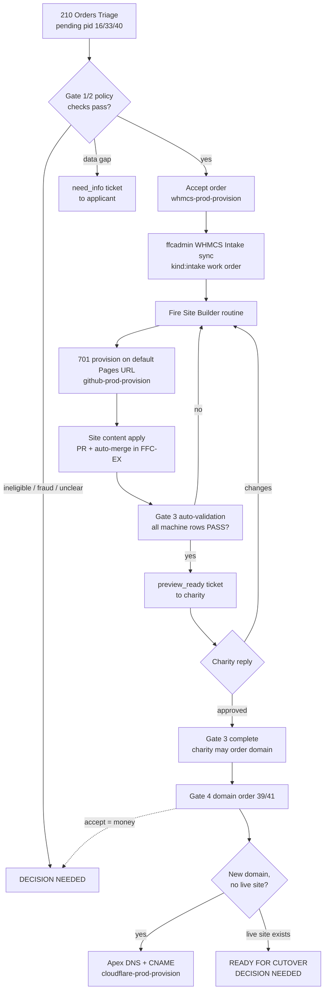

# Charity-lane pipeline: unattended onboarding from application to preview

**Status:** design, adopted by Clarke on 2026-10-11. Parts marked **(build)** do not exist yet; the
[build order](#build-order) lists them.

This is the automated version of ffcadmin's four-gate journey. The journey itself (policy, gates,
proof fields) stays authoritative in FFC-IN-ffcadmin.org:
[gated-journey-operator-runbook.md](https://github.com/FreeForCharity/FFC-IN-ffcadmin.org/blob/main/docs/gated-journey-operator-runbook.md)
and
[application-prerequisites-inventory.md §4a/4b](https://github.com/FreeForCharity/FFC-IN-ffcadmin.org/blob/main/docs/application-prerequisites-inventory.md).
This page says **who does each step without a human**, through which workflow, and where it stops.

## Why it can run unattended

These are new or small charity sites. Nothing a non-technical reviewer can judge exists until the
site is running at a real URL. Code review is not how a charity reviews a website. The meaningful
human review is the charity looking at its finished site on the GitHub Pages default URL. So every
step up to that point is automated, and a human is pulled in only for a **real problem** (below) or
a **Tier 2** action.

## Three tiers

| Tier                     | Who                                    | Does                                                                                                                       |
| ------------------------ | -------------------------------------- | -------------------------------------------------------------------------------------------------------------------------- |
| 1. Workers               | Site Builder routine (and future ones) | Narrow, well-understood work: write a charity's site content and deliver it through a hub workflow                         |
| 2. Onboarding Conductor  | Scheduled cloud routine                | Runs the four gates: decides applications, starts workers, validates the preview, notifies the charity, prepares DNS       |
| 3. Clarke                | Phone                                  | Only Tier 2 actions and real problems, as numbered `DECISION NEEDED:` lines on the conductor ledger                        |
| (internal lane) Platform | Platform Conductor                     | Reviews and lands PRs to this hub and to `FFC-IN-*` repos under the AGENTS.md merge rules. Reserved lanes stay with Clarke |

### Two lanes, split by where a change lands

- **Charity lane (`FFC-EX-*`, WHMCS orders, charity tickets):** the Onboarding Conductor acts on its
  own, inside the guards below.
- **Internal lane (this hub, `FFC-IN-*`):** the Onboarding Conductor never pushes to or merges in
  these repos. When the pipeline needs a change here, it opens a PR, and the Platform Conductor (or
  Clarke, for reserved lanes) lands it.

Authority is enforced by **workflows and environments**, not by session instructions. A cloud
session can only reach the repos attached to it, so every write into an `FFC-EX-*` repo goes through
a hub workflow that refuses anything outside policy.

## The flow

### Gate 1: application decision

1. **Find:** `210. WHMCS - Orders Triage` (ungated, `whmcs-prod-read`) lists Pending pid 16 / 33
   orders. For each: `221` then `219` (both ungated) to read the application by org/domain, never by
   the masked first names in 210.
2. **Check:** the conductor runs the inventory §5 validation set:
   - the Facebook and LinkedIn **organization** Page URLs resolve;
   - for pid 33, the EIN is a 501(c)(3) on ProPublica and the Candid profile matches;
   - the track matches the legal-status answer (a 501(c)(3) on pid 16 or the reverse is a gap);
   - the ToS and US attestations are ticked;
   - no duplicate client, org or domain (`221`);
   - `228. WHMCS - Fraud Review` (ungated) passes.
3. **Decide:**
   - **All pass:** accept that one order through the accept workflow on `whmcs-prod-provision`
     **(build)**. The workflow re-runs the same checks itself
     (`scripts/onboarding-accept-policy.ps1` **(build)**) and refuses if any fails, so the conductor
     cannot accept around policy. One order per dispatch; there is still no bulk accept. Acceptance
     sends WHMCS's acceptance email.
   - **Data gap** (missing page, track mismatch): open a `need_info` ticket to the applicant
     (templated, `whmcs-prod-provision` **(build)**). The order stays Pending and is re-checked next
     run.
   - **Ineligible, fraud flag, or anything the checks cannot classify:** `DECISION NEEDED`. Cancels
     and fraud marks stay Tier 2 until the accept policy has a track record.
4. Acceptance turns the service **Active**. ffcadmin's `WHMCS Intake` sync (daily 08:00 UTC; the
   conductor may dispatch it early) opens the `kind:intake` work-order issue. That issue is the
   charity's tracking record for the rest of the flow.

### Gate 2: website order (pid 40)

Same loop for Pending pid 40 orders: resolve the referenced application, confirm the pid 16/33
service is **Active**, then accept through the same provision workflow, which enforces the
"referenced Gate 1 service is Active" rule itself. Automation-placed marker orders from `224` need
no gate.

### Gate 3: build and validate on the default Pages URL

1. **Repo name:** `FFC-EX-<domain>` from the application's desired domain. pid 33 has no domain
   question, so a missing desired domain is a `need_info` ticket, not a guess.
2. **Start the worker:** the conductor fires the **Site Builder** routine through its API trigger
   with the work-order URL as payload. The worker treats the payload as data and re-reads everything
   from the work order and WHMCS.
3. **Provision:** `701. Website - Provision` with `dry_run=false`. A charity at this gate has no FFC
   zone yet, so 701 publishes on `https://freeforcharity.github.io/FFC-EX-<domain>/` and skips DNS.
   Its `repo` and `content` jobs move to `github-prod-provision` **(build)**, which only ever writes
   `FFC-EX-*` repos.
4. **Content:** the worker builds `site.config.ts` from ffcadmin's footer bridge
   (`scripts/generate-footer-config.mjs`, fail-closed: a gap becomes a `need_info` ticket) plus page
   copy from the mission and program fields. It delivers through **Site content apply** **(build)**,
   a hub workflow that opens a PR in the `FFC-EX-*` repo and auto-merges it once the site's own CI
   is green. That workflow refuses any repo outside `FFC-EX-*`.
5. **Validate:** ffcadmin's `Gate 3 Auto-Validation` on the work order, extended **(build)** to
   cover the rows it reports as MANUAL today: CI status, required template sections, a 375px
   Playwright pass, console errors, and axe / Lighthouse accessibility ≥ 90. The conductor ticks
   each box whose row PASSes and writes the `Live site:` URL. A FAIL goes back to the worker; a
   second consecutive FAIL on the same row is a real problem.
6. **Charity review:** when every machine row passes, the conductor opens a `preview_ready` ticket
   **(build)** to the charity with the preview URL. The charity's reply (read through `209`) is
   either change requests, which go back to the worker, or approval, which ticks the final
   content-review box. **Gate 3 complete** means the charity may order its domain.

### Gate 4: domain and DNS

- The domain order (pid 39 register, pid 41 transfer) is FFC's first spend. `225` (ungated) verifies
  the order's Pages URL. **Accepting it stays Tier 2**: the conductor posts the verified order as
  `DECISION NEEDED`.
- **New domain, no live site:** once the zone is in FFC Cloudflare, the conductor runs the apex
  step: GitHub Pages apex records + `www`, then the held `CNAME` change in the `FFC-EX-*` repo, on
  `cloudflare-prod-provision` **(build)**. A `classify` job refuses if the apex or `www` already
  answers from a non-GitHub origin, or if an existing record of a different type or target would be
  overwritten. Mail records are left to the charity's own tenant (lifecycle Phase 2).
- **Domain already serving a live site:** the conductor stops at **ready for cutover**: `121`
  preflight READY, held `CNAME` PR open, preview approved by the charity. The cutover itself (`120`)
  is Tier 2.

## Real problems (the only escalations)

- A check the policy cannot classify, an ineligible applicant, or a fraud flag.
- The same validation row failing twice in a row, or a worker run that ends without delivering.
- Any workflow guard refusal (it means the conductor asked for something outside policy).
- Anything Tier 2: money (domain orders), a live site's DNS, cancels, deletes, identity or
  permission changes, anything in the internal lane's reserved paths.

## Agents

| Agent                | Kind                                   | Repos attached                | Can                                                                                                                  | Cannot                                                                              |
| -------------------- | -------------------------------------- | ----------------------------- | -------------------------------------------------------------------------------------------------------------------- | ----------------------------------------------------------------------------------- |
| Onboarding Conductor | Routine, every 2 h + Run now           | this hub, FFC-IN-ffcadmin.org | Dispatch read and `*-provision` workflows (REST `…/dispatches`), comment and tick work orders, fire the Site Builder | Push or merge in the hub or `FFC-IN-*`; approve a reviewer-gated environment        |
| Site Builder         | Routine, API trigger only              | FFC-IN-ffcadmin.org, this hub | Generate content, dispatch Site content apply, report on the work order                                              | Accept orders, touch DNS, merge outside its own `FFC-EX-*` delivery                 |
| Platform Conductor   | Routine (replaces the local conductor) | this hub                      | Land green PRs to the hub and `FFC-IN-*` per AGENTS.md                                                               | Reserved lanes (`.github/workflows/`, `.github/actions/`, `.claude/hooks/`, policy) |

Handoffs: the conductor starts the Site Builder with `POST /v1/claude_code/routines/<id>/fire`. The
response carries the new session URL, which the conductor records on the work order. Each fire is a
new session with no idempotency, so the conductor records the session before firing again and fires
at most once per work order per run.

Cloud facts that shape this (measured 2026-10-11): `gh workflow run` fails in cloud sessions because
it calls GraphQL, so dispatch through `gh api -X POST …/actions/workflows/<file>/dispatches`. Repo
hooks do load in a single-repo cloud session, but a multi-repo session reads no repo settings, which
is why the guards live in workflows.

## Guards that make Tier 1 safe

- **Provision environments** with no required reviewer and a `main`-only deployment branch policy:
  `whmcs-prod-provision`, `github-prod-provision`, `cloudflare-prod-provision` **(build)**. The
  reviewer environments keep their reviewer and serve only Tier 2.
- **Input guards inside each provision workflow:** `FFC-EX-*` only, one WHMCS order per run with the
  policy re-check, ticket templates from an allowlist in `config/whmcs-ticket-templates.json`, apex
  writes only through `classify`.
- **Audit:** every provision run comments the run URL on the work order, and the conductor's ledger
  lists them daily.
- **Identity (phase 2):** all agents act as `clarkemoyer` today, so GitHub cannot tell them apart. A
  dedicated GitHub App for the charity lane, with write on `FFC-EX-*`, issues on ffcadmin and
  `actions: write` on this hub, makes the lane boundary a GitHub permission.

## Build order

1. This document. Cross-link from `charity-onboarding-lifecycle.md` and ffcadmin's runbook.
2. Provision environments and the guarded accept / ticket / provision changes in `226` (single-order
   approve), `211` (pid 40 with the Gate 1 check), `205` (templated tickets), `701` (`repo` and
   `content` on `github-prod-provision`). Reserved lane: Clarke merges.
3. **Site content apply** workflow and the Site Builder routine with its API trigger.
4. Gate 3 auto-validation extension (ffcadmin).
5. `classify` job and the new-domain apex step.
6. Onboarding Conductor brief at `.claude/routines/onboarding-conductor.md`; rename the test routine
   `FFC Conductor` to `Onboarding Conductor` and widen it gate by gate as each piece lands.
7. Phase 2 identity.
