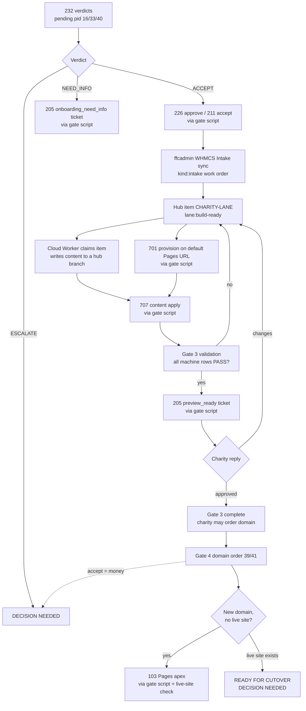

# Charity-lane pipeline: unattended onboarding from application to preview

**Status: TESTING PERIOD.** Adopted by Clarke on 2026-10-11 and under test until the charity-lane
epic [#1618](https://github.com/FreeForCharity/FFC-Cloudflare-Automation/issues/1618) (label
`epic:charity-lane`) shows every step working end to end on real charities. The epic's tracker is
the live record of which steps work today; this page is the design.

**Constraint (Clarke, 2026-10-11):** the pipeline runs on capabilities and credentials that already
exist: no new GitHub environments, no new tokens, no new cloud environments.

This is the automated version of ffcadmin's four-gate journey. The journey itself (policy, gates,
proof fields) stays authoritative in FFC-IN-ffcadmin.org:
[gated-journey-operator-runbook.md](https://github.com/FreeForCharity/FFC-IN-ffcadmin.org/blob/main/docs/gated-journey-operator-runbook.md)
and
[application-prerequisites-inventory.md §4a/4b](https://github.com/FreeForCharity/FFC-IN-ffcadmin.org/blob/main/docs/application-prerequisites-inventory.md).
This page says **who does each step without a human**, through which workflow, and where it stops.

## Why it can run unattended

These are new or small charity sites. Nothing a non-technical reviewer can judge exists until the
site is running at a real URL. Code review is not how a charity reviews a website. The meaningful
human review is the charity looking at its finished site on the GitHub Pages default URL. So every
step up to that point is automated, and a human is pulled in only for a **real problem** (below) or
a **Tier 2** action.

## Three roles

"Tier 1" and "Tier 2" in this document always mean the **action** classes from
[human-intervention-map.md](human-intervention-map.md) (Tier 2 = money, a live site's DNS, cancels,
deletes, identity). The actors are named roles:

| Role                          | Who                                                                             | Does                                                                                                                       |
| ----------------------------- | ------------------------------------------------------------------------------- | -------------------------------------------------------------------------------------------------------------------------- |
| Workers                       | The Agentic OS Cloud Worker routine, picking up tagged items                    | Narrow, well-understood work: write a charity's site content and hand it to the conductor                                  |
| Onboarding Conductor          | The `FFC Conductor` routine (brief: `.claude/routines/onboarding-conductor.md`) | Runs the four gates: decides applications, queues workers, delivers content, validates the preview, prepares DNS           |
| Clarke                        | Phone                                                                           | Only Tier 2 actions and real problems, as numbered `DECISION NEEDED:` lines on the conductor ledger (#1608)                |
| Platform (internal lane only) | Platform Conductor                                                              | Reviews and lands PRs to this hub and to `FFC-IN-*` repos under the AGENTS.md merge rules. Reserved lanes stay with Clarke |

Workers run on their own schedule rather than as subagents inside the conductor's session. That
keeps the builder and the checker separate, isolates a failed build from the conductor's run, and
gives each build its own session as an audit trail (Clarke, 2026-10-11).

### Two lanes, split by where a change lands

- **Charity lane (`FFC-EX-*`, WHMCS orders, charity tickets):** the Onboarding Conductor acts on its
  own, inside the gate policy.
- **Internal lane (this hub, `FFC-IN-*`):** the Onboarding Conductor never pushes to or merges in
  these repos. When the pipeline needs a change here, it opens a PR, and the Platform Conductor (or
  Clarke, for reserved lanes) lands it.

A cloud session can only reach the repos attached to it, so every write into an `FFC-EX-*` repo goes
through a hub workflow that refuses any repo outside `FFC-EX-*`.

## The flow

### Gate 1: application decision

1. **Verdicts:** the conductor dispatches `232. WHMCS - Charity-Lane Verdicts` (ungated,
   `whmcs-prod-read`). It returns one PII-free row per Pending pid 16 / 33 order: ACCEPT, NEED_INFO
   or ESCALATE, with reason codes. The checks are the machine-checkable part of the inventory §5
   set: organization Facebook and LinkedIn pages answer, the ToS and US attestations are ticked, the
   track matches the legal-status answer, the EIN is present (and a confirmed 501(c)(3) for pid 33),
   and there is no duplicate client, org or domain. Every order is then screened with FraudLabs Pro
   exactly as `228` does it (228's `fraudlabspro-prod-read` environment and key), deciding on the
   FraudLabs status alone: `APPROVE` passes, `REJECT` is ESCALATE `FRAUD_FLAGGED`, `REVIEW` is
   ESCALATE `FRAUD_REVIEW`, and a failed or missing lookup is ESCALATE `FRAUD_CHECK_FAILED`. The
   score is reported but never decisive: a high score on a $0 onboarding order is the documented
   false-positive pattern (#813). The decision table is the `finalize` job's; the WHMCS job's own
   report is unscreened and is transport only.
2. **Decide:**
   - **ACCEPT:** `226` in `approve` mode with exactly that one order id, through the gate script
     (rule `226-approve-one`). `226 approve` sends WHMCS's acceptance email. At most three accepts
     per run during the testing period; still no bulk accept.
   - **NEED_INFO:** `205` with the `onboarding_need_info` template and a plain-English list of the
     missing items (rule `205-templated`), at most once per order per week. The order stays Pending
     and is re-checked next run.
   - **ESCALATE:** a `DECISION NEEDED` line. Cancels and fraud marks stay Tier 2.
3. Acceptance turns the service **Active**. ffcadmin's `WHMCS Intake` sync (daily 08:00 UTC) opens
   the `kind:intake` work order, which carries the Gate 3 checklist.

### Gate 2: website order (pid 40)

Same loop for Pending pid 40 orders. The 232 verdict confirms the referenced pid 16/33 service is
**Active**; an ACCEPT goes through `211 action=accept` (rule `211-accept-one`). Automation-placed
marker orders from `224` need no gate.

### Gate 3: build and validate on the default Pages URL

1. **Queue:** for each accepted charity the conductor keeps exactly one hub issue titled
   `[CHARITY-LANE] <domain or org>` labelled `charity-lane` and `lane:build-ready`, linking the
   ffcadmin work order. Labels move it through `lane:building`, `lane:built` and `lane:validate`.
2. **Repo name:** `FFC-EX-<domain>` from the application's desired domain. pid 33 has no domain
   question, so the conductor first searches for an existing site (750's EIN-based query, then a web
   search) and otherwise sends an `onboarding_need_info` ticket asking for the domain; it never
   guesses. A charity found to have its own live site is provisioned with 701 `skip_dns=true` and
   follows the ready-for-cutover path.
3. **Provision:** `701. Website - Provision` with `dry_run=false` through the gate script (rule
   `701-provision`). A charity at this gate has no FFC zone yet, so 701 publishes on
   `https://freeforcharity.github.io/FFC-EX-<domain>/` and skips DNS.
4. **Content:** the Cloud Worker claims the item, builds `src/lib/site.config.ts` from the
   application (ffcadmin's footer bridge, fail-closed) and page data under `src/data/`, and pushes
   the files to the hub branch `claude/site-content/<domain>`. That branch is transport only and is
   never merged. The conductor then delivers it with `707. Website - Content Apply`, which opens a
   PR in the `FFC-EX-*` repo and accepts only allowlisted content paths. **Known gap:** FFC-EX repos
   have auto-merge off and no required checks, so the content PR is left open until it is merged
   (epic item G3.3b).
5. **Validate:** ffcadmin's `Gate 3 Auto-Validation` covers HTTP 200, the footer markers, viewport
   and broken asset paths today. CI status, required sections, a 375px pass, console errors and
   accessibility are still MANUAL rows (epic item G3.4). A FAIL goes back to the worker; a second
   consecutive FAIL on the same row is a real problem.
6. **Charity review:** when every machine row passes, the conductor sends `205` with the
   `preview_ready` template and the preview URL. The charity's reply (read through `209`) is either
   change requests, which go back to the worker, or approval, which completes Gate 3: the charity
   may order its domain.

### Gate 4: domain and DNS

- The domain order (pid 39 register, pid 41 transfer) is FFC's first spend. `225` (ungated) verifies
  the order's Pages URL. **Accepting it stays Tier 2**: the conductor posts the verified order as
  `DECISION NEEDED`.
- **New domain, no live site:** once the zone is in FFC Cloudflare, the conductor runs `103` with
  `github_pages_only=true` and `skip_m365=true` (rule `103-pages-apex`), then the `CNAME` change in
  the `FFC-EX-*` repo. The gate script runs a live-site check first and refuses if the apex or `www`
  already points outside GitHub Pages or answers from a non-GitHub server. Mail records are left to
  the charity's own tenant (lifecycle Phase 2).
- **Domain already serving a live site:** the conductor stops at **ready for cutover**: `121`
  preflight READY, preview approved by the charity. The cutover itself (`120`) is Tier 2.

## Queue labels

Each charity has one hub issue, `[CHARITY-LANE] <domain or org>`, labelled `charity-lane` plus
exactly one lane label. Every transition removes the previous lane label.

| Label                 | Meaning                                                      | Set by    | Next                                         |
| --------------------- | ------------------------------------------------------------ | --------- | -------------------------------------------- |
| `lane:build-ready`    | Accepted; waiting for the Cloud Worker                       | conductor | `lane:building`                              |
| `lane:building`       | A worker has claimed it (lease in a claim comment)           | worker    | `lane:built`, `lane:needs-info`              |
| `lane:needs-info`     | The application is missing data; `onboarding_need_info` sent | worker    | `lane:build-ready` once the data changes     |
| `lane:built`          | Content is on `claude/site-content/<domain>`                 | worker    | `lane:validate` after 707 delivers and lands |
| `lane:validate`       | Preview is live; Gate 3 checks running                       | conductor | `lane:charity-review`, or back to build      |
| `lane:charity-review` | `preview_ready` ticket sent; waiting for the charity         | conductor | `lane:gate3-done`, or back to build          |
| `lane:gate3-done`     | The charity approved its preview                             | conductor | Gate 4                                       |
| `lane:live`           | Brand-new domain serving the site on its apex                | conductor | (done)                                       |

## Gate clearing

Clarke authorized the conductor (2026-10-11) to clear environment gates for these steps on the
existing reviewer environments. It does so **only** through `scripts/charity_lane_gate.py`, against
`config/charity-lane-gate-policy.json`:

- The script checks the request against one rule. Inputs are a closed set with enum, pattern and
  length limits; anything unlisted is refused before dispatch.
- It dispatches the run itself, identifies exactly that run, and approves only the environments the
  rule lists. It never approves a run it did not dispatch.
- Cloudflare writes also need the live-site check to pass.
- Every use posts an audit comment on #1608 (contact inputs redacted). Refusals are left waiting for
  Clarke.
- Never allowed: `211` cancel or fraud, `226` reconcile or multi-order approve, `113` register,
  `120` cutover, accepting a domain order, any `m365-prod` write.

The policy file is the authority; changing it changes what an unattended agent may approve, so it is
a policy change for Clarke. `.claude/settings.json` allows only the script's subcommands, not raw
`pending_deployments` calls.

## Real problems (the only escalations)

- An ESCALATE verdict, an ineligible applicant, or a fraud flag.
- The same validation row failing twice in a row, or a worker run that ends without delivering.
- A gate-script refusal, or a waiting gate the conductor did not dispatch.
- Anything Tier 2: money (domain orders), a live site's DNS, cancels, deletes, identity or
  permission changes, anything in the internal lane's reserved paths.

## Cloud facts that shape this (measured 2026-10-11)

- `gh workflow run` fails in cloud sessions because it calls GraphQL; dispatch through
  `gh api -X POST …/actions/workflows/<file>/dispatches`.
- A cloud session reaches only its attached repos, so the hub is the only writer into new `FFC-EX-*`
  repos.
- Repo hooks and settings load in a single-repo cloud session; a multi-repo session reads no repo
  settings.

## Components

| Piece                             | Where                                                                            | PR                       |
| --------------------------------- | -------------------------------------------------------------------------------- | ------------------------ |
| Design (this page)                | `docs/charity-lane-pipeline.md`                                                  | #1617, #1624             |
| Gate 1/2 verdicts                 | `232-whmcs-charity-lane-verdicts.yml`                                            | #1620                    |
| Gate clearing                     | `scripts/charity_lane_gate.py`, `config/charity-lane-gate-policy.json`           | #1621, #1627             |
| Conductor brief                   | `.claude/routines/onboarding-conductor.md`                                       | #1622, #1625, #1630      |
| Content delivery                  | `707-website-content-apply.yml`; `205` templates                                 | #1623                    |
| Land content PRs (G3.3b)          | `707` waits for the site's CI, then merges                                       | #1626                    |
| Worker brief and queue            | `.claude/routines/site-builder.md`                                               | #1625                    |
| Duplicate lookup                  | `750-charity-lane-lookup.yml`, `scripts/charity_lane_lookup.py`                  | #1628                    |
| Existing live site: build, no DNS | `701` input `skip_dns`                                                           | #1631                    |
| Onboarding need-info ticket       | `onboarding_need_info` in `config/whmcs-ticket-templates.json`                   | #1632                    |
| Charity reply classifier          | `233-whmcs-charity-lane-ticket-reply.yml` (no reply text printed)                | #1638                    |
| Public website fields             | `234-whmcs-charity-lane-site-fields.yml`, `config/charity-lane-site-fields.json` | #1639                    |
| Gate 3 validation rows            | ffcadmin `gate3-validate`                                                        | FFC-IN-ffcadmin.org#1448 |
| Fraud screening in the verdicts   | `232` + FraudLabs via `fraudlabspro-prod-read`                                   | (build)                  |
